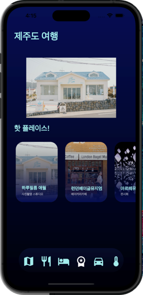
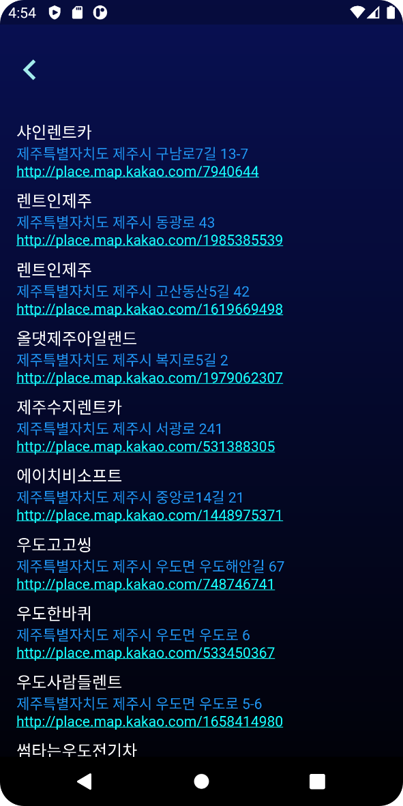
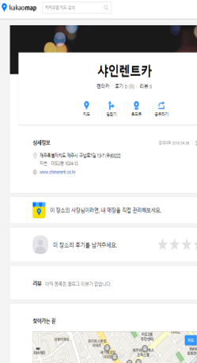
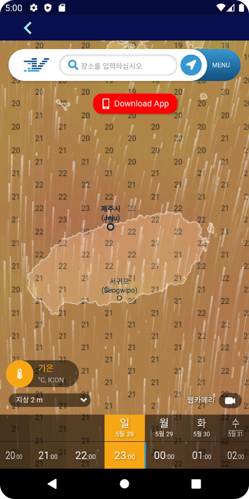

# Jeju Travel Guide (Flutter)

해당 프로젝트는 제주도 여행 가이드 어플을 Android Studio(Flutter)를 활용하여 개발한 것입니다. 
어플 시작시 보이는 메인 화면입니다. 하단에 제주도 핫플레이스가 위치합니다. 
 
렌터카 업체를 볼 수 있는 목록입니다. 
 
클릭 시 해당 업체 정보를 볼 수 있습니다. 
 
제주도 날씨 관련 사항을 볼 수 있는 곳을 Api를 활용하여 연결하였습니다. 
 
