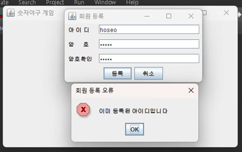
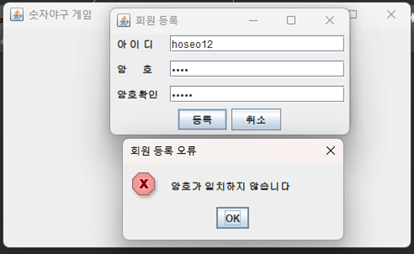
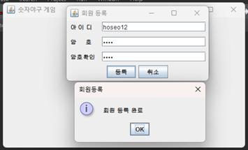
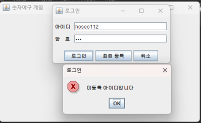
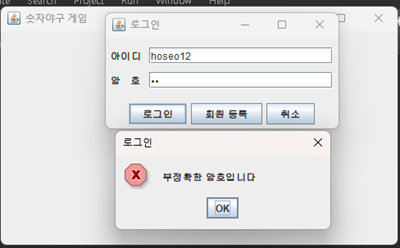
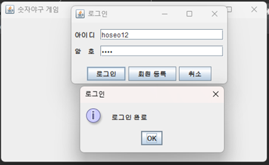
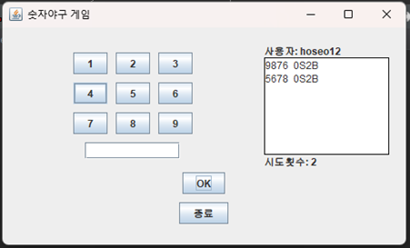
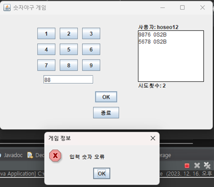
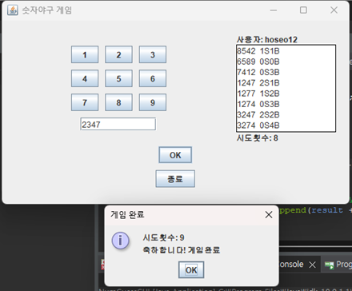

# Number Baseball with Login (Java GUI)
해당 프로젝트는 숫자야구 게임을 하는 것에 로그인 기능을 추가한 것입니다. 
회원 등록할 아이디가 이미 존재할 시 오류 출력 
 
회원 등록에서 암호와 암호확인 타이핑이 다를 경우 오류 출력 
 
회원 등록에 성공할 시 출력 
 
로그인 시 등록되지 않은 아이디로 로그인 시도 시 오류 출력 
 
로그인 시 잘못된 암호로 로그인 시도 시 오류 출력 
 
로그인에 성공할 시 출력 
 
로그인에 성공하고 숫자야구 메인화면 
 
숫자 4자리가 아닌 잘못된 숫자를 넣을 시 오류 출력 
 
정확하게 숫자를 맞출 시 출력 
 
