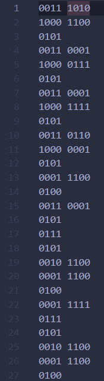
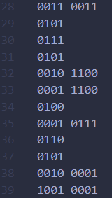
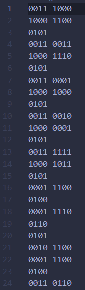
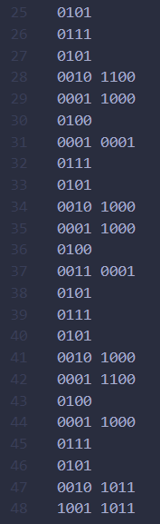

# OS Practice: 명령어 단위 연산 실습
8. D = A – 1 - C – 3 + B 구현하고, D를 출력하라. 
 * A값 : 1010 (메모리주소 1100) 
 * B값 : 0001 (메모리주소 0111) 
 * C값 : 0001 (메모리주소 1111) 
 * D값 : 0110 (메모리주소 0001) 
WRITE A 1100 1010 
WRITE B 0111 0001 
WRITE C 1111 0001 
WRITE D 0001 0110 
SUB A 0001 
STORE A 
SUB A C 
STORE A 
SUB A 0011 
STORE A 
ADD A B 
STORE D 
PRINT D 
 
 

16. E = A + B - 6 - C – D – 1 구현하고, E를 출력하라. 
 * A값 : 1000 (메모리주소 1100) 
 * B값 : 0011 (메모리주소 1110) 
 * C값 : 0001 (메모리주소 1000) 
 * D값 : 0010 (메모리주소 0001) 
 * E값 : 1111 (메모리주소 1011) 
WRITE A 1100 1000 
WRITE B 1110 0011 
WRITE C 1000 0001 
WRITE D 0001 0010 
WRITE E 1011 1111 
ADD A B 
STORE A 
SUB A 0110 
STORE A 
SUB C D 
STORE C 
SUB C 0001 
STORE C 
SUB A C 
STORE E 
PRINT E 
 

